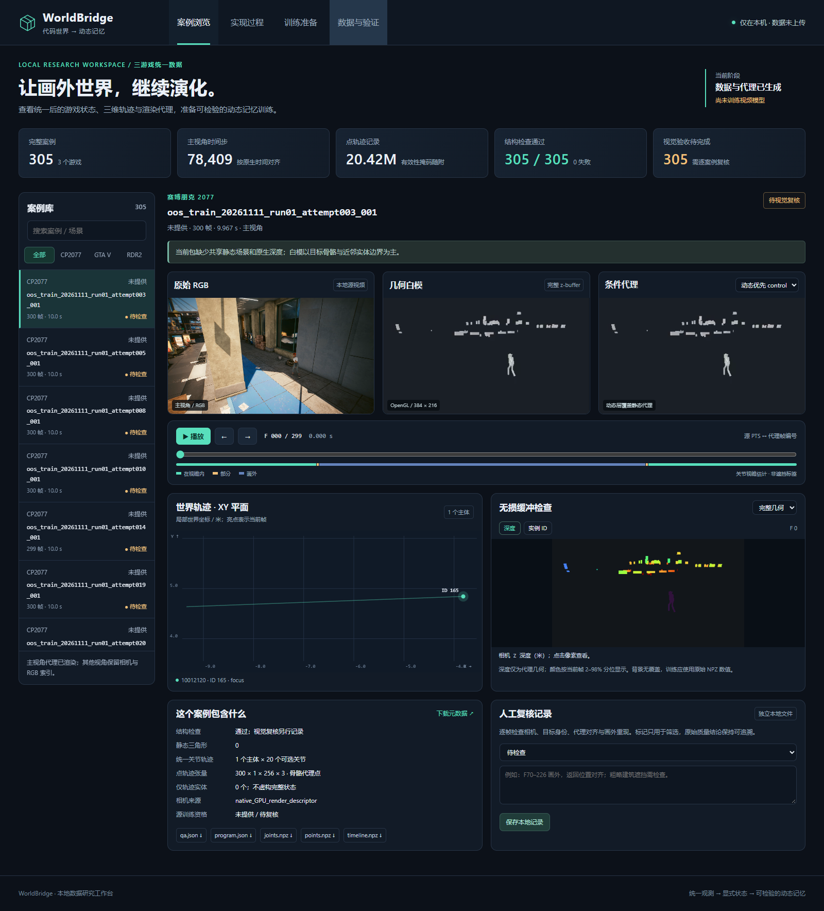

# CodeAsMem

[中文](README.md) · [Architecture](docs/architecture.md) · [Data contract](docs/data.md) · [Training](docs/training.md)

Local data preparation for dynamic memory in video generation. The **WorldBridge** component unifies captured Cyberpunk 2077, GTA V and RDR2 states, cameras, geometry and behavioral evidence into one scene contract. Native Windows OpenGL produces inspectable proxy conditions; a local dashboard supports review and causal training-window preparation.

The completed local batch contains 305 episodes, 78,409 main-view timesteps and 1,220 proxy videos (four representations per episode). All 305 episodes passed structural validation. This does **not** establish visual training eligibility. Historical aggregate reports are included; the original recordings and the roughly 17 GB generated dataset are not.

Implemented: adapters, scene IR, joint / point tracks, recorded replay, explicit constant-velocity rollout, proxy rendering, frame-aligned loaders, a local dashboard and separated historical inputs / future labels. Learned dynamics, video-model weights, D4RT integration and native game AI / physics recovery are future work.

## Quick start

Python 3.10+, `ffmpeg` and `ffprobe` on PATH. The WGL rendering backend requires Windows and an OpenGL 4.3+ driver. Conversion and array loading do not require a GPU.

```powershell
git clone https://github.com/Anachronism-N/CodeAsMem.git
cd CodeAsMem
python -m pip install -e ".[web,test]"
Copy-Item configs/example.json configs/local.json
# Set your own absolute source paths in configs/local.json.
python -m worldbridge scan --config configs/local.json
python -m worldbridge batch --config configs/local.json --limit 1
python -m worldbridge validate --root data/unified_worlds
```

Configuration output paths are relative to the configuration file. Raw source layout and game-specific limitations are documented in [reproducibility](docs/reproducibility.md). Input source scripts are not executed. Completed conversions are reused; use a new output directory when adapter rules change.

## Local dashboard

```powershell
powershell -NoProfile -ExecutionPolicy Bypass -File web/start.ps1 -DataRoot "D:/datasets/unified_worlds"
```

Open `http://127.0.0.1:8877`. Add `-Port 8878` for a different port. Stop with `web/stop.ps1`. With the environment variable `CODEASMEM_DATA_ROOT` set, `python web/app.py --port 8877` also works; the WGL renderer remains Windows-only.

The browser displays complete main-view episodes, RGB / proxy comparisons, trajectories, lossless buffer inspection and local review annotations. Source RGB is streamed from local files. Exact paused-frame selection preserves MP4 presentation offsets and handles very short final frames. Proxy preview clocks are CFR; simulation `time_us` remains separate.



## Training preparation

Export a window JSON from the dashboard, then:

```powershell
python scripts/prepare_window.py --recipe "window.json" --out prepared/sample_001
```

The script writes `student_inputs.npz`, `supervision.npz` and `provenance.json`. Dynamics inputs contain past RGB and timestamps only by default. Future states, tracks and images are supervision. `--oracle-history` explicitly enables a privileged historical engine-state baseline. Renderer windows allow recorded future proxies and cameras as known conditions.

Recommended progression: manually review 10–20 examples, split by scene / identity / capture session before windowing, overfit a conditional renderer, evaluate causal dynamics against hold-position / constant-velocity baselines, then integrate persistent memory. No model weights are trained by this repository's preparation commands.

## Validation and limits

```powershell
python -m pytest -m "not gpu" -q
python -m pytest -q  # includes WGL test on Windows
```

Historical reports cover 305-episode structural validation, 63 local web / data checks and 18 browser-versus-decoder frame checks. See [reports](reports/README.md) for their scope and [tests](tests/) for runnable repository tests.

Proxy `covered` is not native pixel visibility; proxy depth is coarse geometric camera-Z depth. The `control` representation ignores static occlusion. CP / GTA 256-point bone proxies and RDR 19-point skeletons are not equivalent real-surface correspondences. Missing states remain unknown with explicit masks. The supplied RDR source marks training eligibility false and requires quality review. Future teacher views and future ground-truth proxies must not enter a causal dynamics student's input.

Research reference: [arXiv:2512.08924](https://arxiv.org/abs/2512.08924). This repository does not implement that paper's model or establish a K-only memory training scheme.

