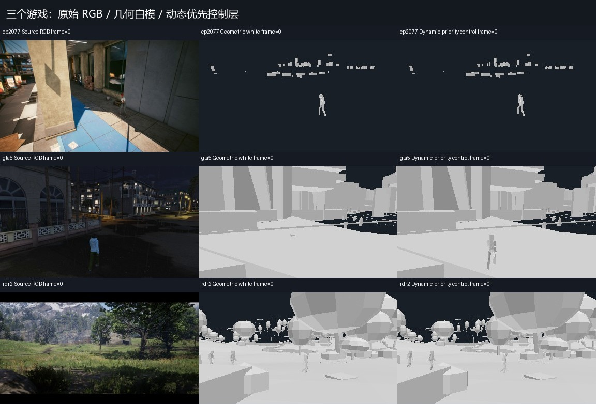
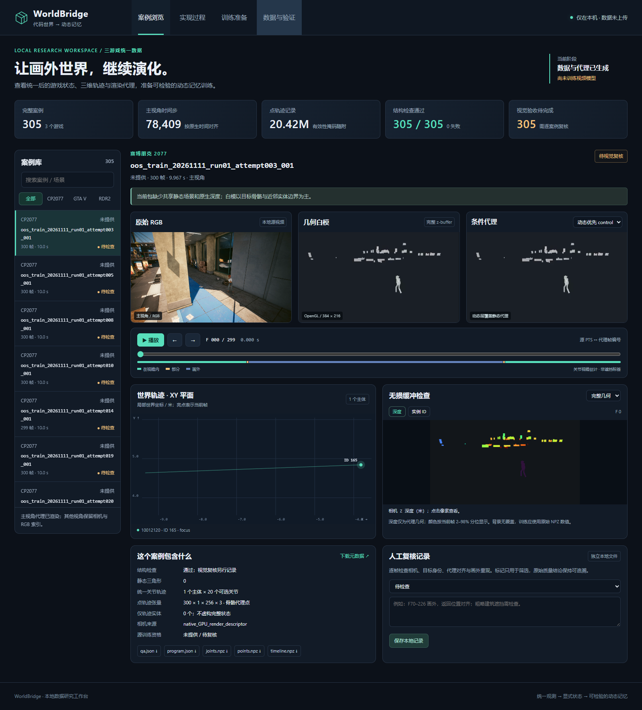

# CodeAsMem

[English](README.en.md) · [架构](docs/architecture.md) · [数据格式](docs/data.md) · [训练路线](docs/training.md) · [网页使用](docs/web.md) · [复现与验证](docs/reproducibility.md)

面向视频生成动态记忆的本地数据与代理工具链。当前工程组件 **WorldBridge** 将 Cyberpunk 2077、GTA V、Red Dead Redemption 2 的采集输出转换为共同世界表示，再生成可检查、可配对的三维代理条件。

```text
游戏视频 / 状态 / 相机 / 行为证据
                ↓ 三游戏适配器
统一场景 IR：实体身份、仿真时间、坐标、相机、骨骼、事件
                ↓ 重放 / 显式程序接口
OpenGL 代理：white / semantic / actors / control + 无损数值缓冲
                ↓ 帧编号配对
案例浏览、人工复核、因果窗口准备 → 后续视频 / 动力学 / 记忆训练
```



## 当前进度

| 游戏 | 完整案例 | 主视角时间步 |
|---|---:|---:|
| Cyberpunk 2077 | 50 | 15,003 |
| GTA V | 79 | 10,756 |
| RDR2 | 176 | 52,650 |
| 合计 | **305** | **78,409** |

本地处理批次生成了 **1,220 个主视角代理 MP4**（305 案例 × 4 种表示）、20,418,704 个点轨迹记录及有效掩码。结构验证 305/305 通过；逐案例视觉验收仍待完成。四相机索引也有 1,220 条，但只有 305 个 `main` 视角已渲染，两个计数含义不同。

已实现：三游戏适配、共同场景接口、骨骼 / 点轨迹、记录重放、显式匀速推进、原生 Windows OpenGL、帧级训练读取、本地网页、历史输入与未来监督分离。

**尚未实现：** 视频模型或 D4RT 权重训练、学习式画外动力学、原生 AI / 导航 / 碰撞规则恢复。重放未来记录可以构建条件生成样本，但不能独立证明模型学会预测未来。

这些统计是[历史批次快照](reports/README.md)，不表示克隆仓库就包含该批次。原始游戏数据、完整统一输出、模型权重、个人路径、日志和进程状态不在 Git 中；代码默认本地运行。

## 安装

Python 3.10+。转换与数组读取不需要 GPU；当前代理渲染后端需要 **Windows、OpenGL 4.3+ 驱动**。视频编码 / 网页时间索引要求 `ffmpeg` 和 `ffprobe` 在 PATH 中。

```powershell
git clone https://github.com/Anachronism-N/CodeAsMem.git
cd CodeAsMem
python -m pip install -e ".[web,test]"
ffmpeg -version
ffprobe -version
```

安装依赖可能访问包源；数据处理和网页本身不调用远程模型或云服务。已经具备依赖的离线机器可使用 `python -m pip install -e . --no-deps --no-build-isolation`，通过环境本身提供网页 / 测试依赖。

## 接入并转换数据

```powershell
Copy-Item configs/example.json configs/local.json
# 编辑 configs/local.json 的三个 datasets 路径，使用自己的绝对路径。
python -m worldbridge scan --config configs/local.json
python -m worldbridge convert --config configs/local.json --workers 3
python -m worldbridge batch --config configs/local.json --workers 3 --render-workers 3
python -m worldbridge validate --root data/unified_worlds --workers 3
```

`convert` 只转换，`batch` 会复用已有转换结果并生成配置视角的代理。`output` 相对配置文件目录解析；示例指向仓库 `data/unified_worlds`。新规则重跑时使用新的输出目录，避免复用旧转换结果。先用 `--game gta5 --limit 1` 小批验证。完整源目录要求见[复现指南](docs/reproducibility.md)。

已有统一结果时可直接启动网页，无需重跑全部数据：

```powershell
powershell -NoProfile -ExecutionPolicy Bypass -File web/start.ps1 -DataRoot "D:/datasets/unified_worlds"
# 默认 http://127.0.0.1:8877；冲突时加 -Port 8878。
```

默认目录是 `data/unified_worlds`。网页只列出拥有完整 `main` 代理的案例；没有数据时展示接入说明。它支持原始 RGB / 白模 / 控制层对照、逐帧定位、XY 轨迹、深度 / 实例数值查询、真实源码查看及训练窗口下载。



关闭浏览器后后台服务继续运行，停止命令为 `powershell -NoProfile -ExecutionPolicy Bypass -File web/stop.ps1`。跨平台可设置 `CODEASMEM_DATA_ROOT` 后执行 `python web/app.py --port 8877`；这不意味着 WGL 渲染器支持 Linux。更多操作见[网页说明](docs/web.md)。

## 准备训练窗口

在网页“训练准备”选择案例、历史截止帧与未来终帧，下载 JSON，然后从仓库根目录执行：

```powershell
python scripts/prepare_window.py --recipe "下载的窗口.json" --out prepared/sample_001
```

输出为 `student_inputs.npz`、`supervision.npz`、`provenance.json`。

- **dynamics：** 默认输入仅含历史 RGB 和时间；未来轨迹、关节、速度、RGB 只出现在监督文件。
- **renderer：** 未来代理与相机是明确给定的条件，监督为对应 RGB。
- `--oracle-history` 显式加入历史引擎状态，必须作为特权历史状态实验单独报告。

仓库 [examples](examples/) 提供 CP2077 窗口定义；相对 `episode` 路径按 JSON 所在目录解析，实际数据仍需本地提供。数据准备不会训练模型，也不会自动授予训练资格。

推荐顺序：人工复核 10–20 条 → 按场景 / 身份 / 采集批次划分 → 单案例条件视频生成过拟合 → 画外动力学基线 → 内部动态记忆。具体输入、监督、掩码和评价见[训练路线](docs/training.md)。

## 验证

```powershell
python -m pytest -m "not gpu" -q
# Windows + OpenGL 4.3 环境再运行 GPU 测试：
python -m pytest -q
# 有本地完整结果后运行真实数据集校验：
python -m worldbridge validate --root "D:/datasets/unified_worlds"
```

`reports/` 保存历史批次汇总、63 项本地接口 / 浏览器 / 数据准备检查和 18 项实际解码帧对照。仓库整理后的检查单独记录，避免把历史通过结果当成当前克隆环境的验证结果。

## 关键约定

- `covered` 是代理覆盖，不是真实像素可见性；`depth` 是粗几何相机 Z，不是原生深度。
- `control` 把动态层叠在静态代理上，明确忽略静态遮挡；全几何和独立动态深度各自保留。
- CP / GTA 的 256 点是骨骼驱动代理点，RDR 的 19 点是骨骼点；不能当作统一真实表面对应。共同关节采用有效掩码监督。
- 实体缺失表示未知，不等于销毁；缺失状态 / 骨骼保留 null / NaN，不伪造标签。
- CP 包缺共享静态几何与原生深度；GTA / RDR 仍是粗略场景；RDR 源 `training_eligible=false` 需要处理其质量原因。
- 画外预测的学生不能读取未来真实状态、事件、代理或未来辅助视角；辅助视角可作离线教师监督。

研究参考：[arXiv:2512.08924](https://arxiv.org/abs/2512.08924)。本仓库提供数据与代理工程，尚未集成该论文模型；内部记忆的 K/V 投影、读写和训练参数仍需按选定架构设计。

