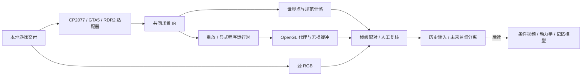

# 架构与实现

CodeAsMem 当前围绕数据与代理接口建立可检查的工程基线。WorldBridge 是其中的场景统一、显式程序与渲染组件；视频模型与学习式世界记忆后续接入。



## 为什么同时保存代码、状态和代理

三游戏的原始交付字段、坐标、相机与行为接口不同。适配器将已观测信息放到共同契约中，而不是把游戏引擎所有代码翻译为等价程序。结构化 JSON、帧流和操作符组成当前轻量 IR / DSL。

白模是从世界状态到画面的投影条件，方便视频模型使用。画外实体不会出现在主视角代理里，因此仍需保存三维状态、身份和时间，不能只保留白模视频。

显式状态让动力学与渲染可分别验证：

```text
状态推进：S(t+Δt) = F(S(≤t), 动作, Δt)
条件投影：P(t) = Render(S(t), Camera(t))
视频生成：I(future) = G(I(history), P(future), 外观条件)
```

目前 `F` 只有记录重放与显式匀速基线，`Render` 已实现，`G` 尚未接入。将记录的未来状态直接代入 `Render`，不等于验证了 `F` 的预测能力。

## 模块对应

| 文件 | 责任 |
|---|---|
| `worldbridge/adapters.py` | 三游戏源格式、相机和状态适配 |
| `worldbridge/common.py` | 身份、类别、规范骨骼、坐标与投影约定 |
| `worldbridge/pipeline.py` | 转换、行为证据封装、配对索引 |
| `worldbridge/tracks.py` | 点轨迹、20 关节与有效掩码 |
| `worldbridge/runtime.py` | 重放和显式 `set_velocity` / `set_state` / `advance` |
| `worldbridge/geometry.py` | 包围几何、实测骨骼与代理网格 |
| `worldbridge/wgl.py` | 原生 Windows WGL / OpenGL 多渲染目标 |
| `worldbridge/render.py` | 四种代理、无损缓冲、预览与编码 |
| `worldbridge/data.py` | 源 RGB 与代理按帧编号读取 |
| `worldbridge/validate.py` | 统一数据、掩码、缓冲与视频结构校验 |
| `web/` | 本地 FastAPI 服务和无构建前端 |
| `scripts/prepare_window.py` | 历史输入 / 未来监督分文件准备 |

## 游戏适配选择

**CP2077：** 使用原生 GPU 相机描述，转换深度约定，保留目标骨骼和附近实体边界。当前交付缺共享静态场景与原生深度，所以不会补造完整街景。玩家状态可保留，但按源策略排除其代理几何。

**GTA V：** 录制侧 commanded camera 比采样名义相机更符合抽查 RGB。来源明确标为 `capture_sidecar_commanded_pose_not_sample_camera`。粗大建筑实体包围盒可能填满庭院 / 街道；有碰撞墙段和水平面时改用它们，巨大或包含相机的边界保留线框。全量像素对齐仍需复核。

**RDR2：** 读取交付的最终相机、编译静态数组、动力学和行为记录，不执行未知源 Python。额外环境骨骼轨迹保留为 `track_only` 身份，不虚构完整帧状态或身体。

## 程序证据边界

`program.json` 的统一操作名不代表原生行为已可跨游戏执行。命令、观测变化和隐藏规则分开解释：

- `request_behavior` 表示采集器曾请求某行为；实际是否执行需看观测。
- `regions/transitions` 保留源状态机证据，未自动恢复游戏后端。
- `replay` 读取记录的未来，只用于重放和条件数据构建。
- `advance` 仅按已有速度平移根与记录姿态；不生成新步态、碰撞或路径规划。
- 未知速度保持未知；实体不在当前观测列表表示未知，而非自动销毁。

## OpenGL 与同步

WGL 创建隐藏窗口和 OpenGL 4.3 上下文，直接调用系统 / 驱动，无需 PyOpenGL。多渲染目标输出颜色、浮点深度、整数实例和类别等。分别渲染全几何与独立动态层；`control` 将动态层叠在静态结果上。

MP4 为保持帧数的 CFR 预览；训练以帧编号和 `time_us` 配对。网页根据源 packet presentation PTS 定位 RGB，根据代理帧率定位代理，保留非零 MP4 起点。部分末帧不到 1ms，不能使用常见的 2ms 末端裁剪定位。历史验证对三游戏首 / 中 / 末 RGB 与 white 共 18 个解码帧做了实际像素比较。

## 后续模型接口

建议先把显式状态与代理当成可检查监督，再设计持久对象 / 世界记忆 token。需要定义历史写入、画外状态更新、按实体与未来时间查询、生成时读取。K 是注意力寻址的一部分，V 承载内容；仅指定“训练 K”不足以确定整个动态记忆实现。当前工程不声称已经接入或复现 D4RT 模型。

